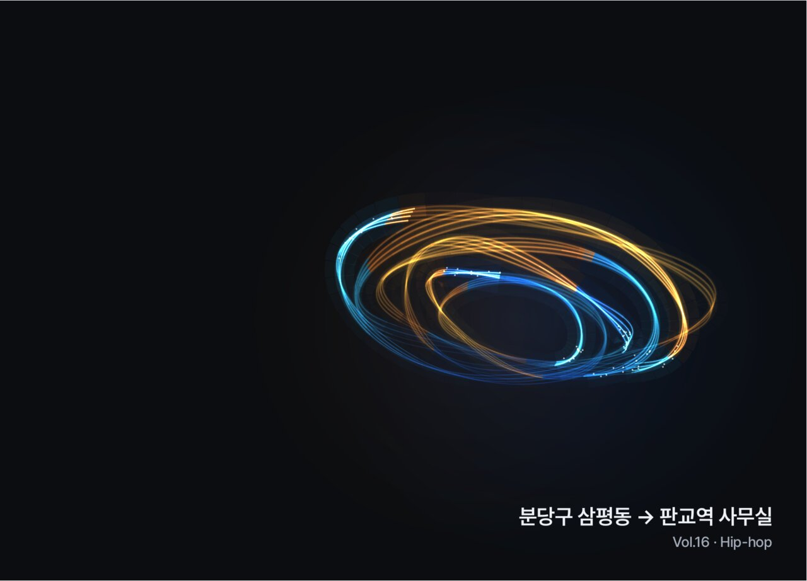
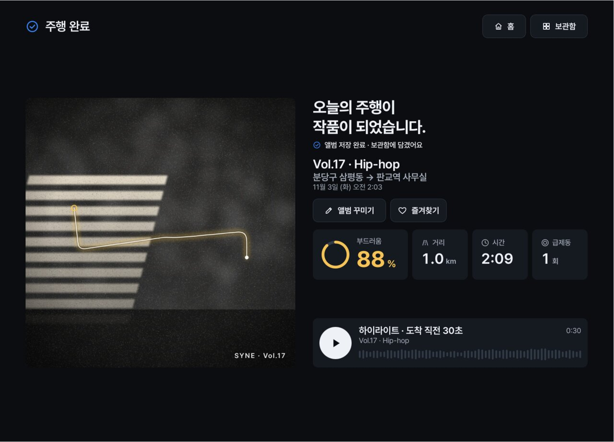
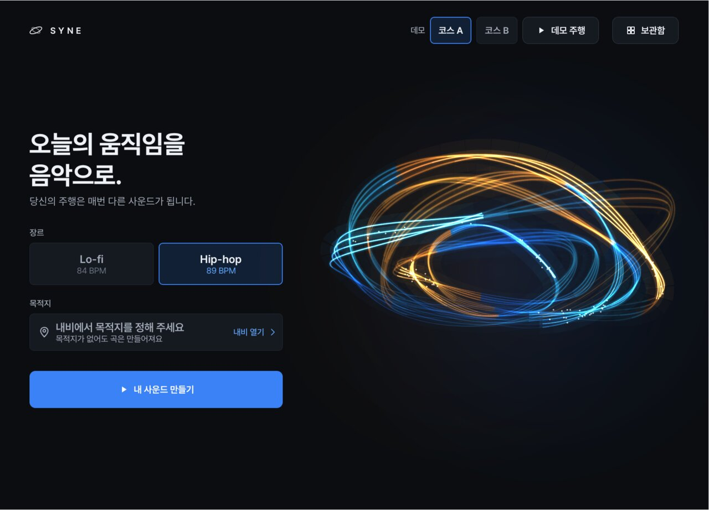
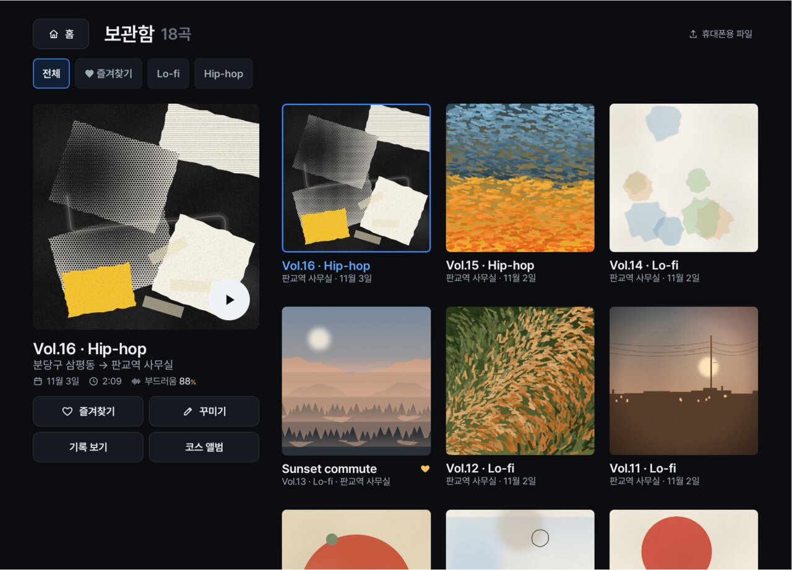

# SYNE (사인) — See Your Sound.

**운전하는 동안 차량 신호로 실시간 작곡하고, 도착하면 그 길을 앨범으로 남기는 차량용 앱.**
속도·조향·브레이크·방향지시등·내비 정보가 악기 편성과 멜로디가 되고, 같은 길을 다시 달리면 같은 앨범의 다음 Vol.이 됩니다.

> 현대자동차그룹 차량용 앱 개발 공모전(Pleos App Market) 출품작 · 1인 개발 · 진행 중
> 플랫폼: Pleos Connect (Android Automotive OS 기반)

- **APK: [`apk/SYNE_release.apk`](apk/SYNE_release.apk)** (release 서명, applicationId `ai.syne.app`, v0.1.0) — 설치 방법은 [실행 방법](#실행-방법)
- **시연 영상: https://youtu.be/pSx3Z_whBS0**

<p>
  
  
</p>

---

## 핵심 기능

### 1. 주행 기반 작곡
실시간 합성 엔진(AudioTrack)이 차량 신호를 받아 곡을 만듭니다. **템포는 장르마다 고정**(Lo-fi 84 BPM · 스윙 56% / Hip-hop 96 BPM 정박 · 펀치 킥·스네어+클랩·16분 하이햇 롤·포화된 808 글라이드·킥 사이드체인·신스 브라스 훅, 모든 장르 상한 100 BPM)하고, 편성 변경은 마디 경계에서만 일어납니다. 장르 팩은 템포·리듬 섹션·음색·믹스만 바꾸고, 조향 멜로디·화성·곡 구조·운전 반응 규칙은 모든 장르가 같은 코드를 씁니다.

| 차량 신호 | 음악 반응 |
|---|---|
| 속도 구간 | 편성 · 멜로디 음색 (5~30km/h pluck / 30~55 keys / 55~ 밝은 lead), 로즈 컴핑은 저속에서 은은하게 |
| 조향각 | 멜로디 음정(A 마이너 펜타토닉으로 양자화) · 좌우 패닝 |
| 방향지시등 | 깜빡이 쪽으로 100% 패닝된 하이햇 액센트 |
| 급제동 (브레이크 + 감속 ≥ 2.9 m/s², 0.3초↑) | 즉시 **테이프 스톱**(0.6초 피치 하강) → 무음 → 리버스 심벌 → 다음 마디 첫 박 **테이프 스핀업**으로 전체 재진입 |
| 신호 정차 / 출발 | 정지 순간 드럼·베이스가 빠지고 패드가 숨 쉬듯 + 리버브 꼬리 / 5km/h를 넘으면 킥 한 방과 함께 재시작 |
| 부드러운 주행 30초 유지 | 패드에 7th·9th 화음 추가 |
| 내비 남은 시간 | 도착에 맞춰 곡 구조 배분 (없으면 시간 기반 구조) |
| 기어 P | 4마디 엔딩 → 2초 리버브 꼬리 페이드 → 기록 저장, 새 트랙 화면이 바로 열림 |

전체에 Lo-fi 질감(LP 크랙클, 테이프 워블, 9kHz 하이컷)이 깔린다. 반응은 오프라인 렌더 테스트로 수치 검증한다(급제동 1초 내 −66dB, 정차 시 저역 −11dB 등).

### 2. 과속하면 곡이 낡는다 — 과속은 절대 보상하지 않는다
속도는 템포가 아니라 **편성에만** 반영됩니다. 제한속도를 넘는 즉시 0.5초에 걸쳐 곡이 '낡은 테이프'처럼 변합니다: 로우패스로 먹먹해지고, 테이프 워블이 ±0.3% → ±2%로 커지고, LP 크랙클이 +12dB, 멜로디는 빠집니다. 편성은 실제 속도가 아니라 **제한속도 기준**으로 계산해 더 빨리 달려도 더 풍성해지지 않습니다. 제한속도 아래로 오면 1마디에 걸쳐 원래대로 돌아옵니다.

### 3. 코스 앨범
출발·도착 지점을 **반경 300m로 클러스터링**해 코스 키를 만들고, 같은 코스의 주행은 같은 앨범의 Vol.1, Vol.2…로 쌓입니다. 50km 이상 주행은 '여행 앨범'으로 분류되고, 장르는 태그로 저장되어 장르별 자동 플레이리스트가 됩니다.
**좌표는 앱 내부 DB에서만 쓰이고, 화면·로그·외부로는 코스 이름만 나갑니다.**

### 4. 주행마다 다른 앨범 아트
곡마다 1024×1024 커버를 한 장씩 만듭니다. **UI는 절제되고 일관되게, 앨범 아트는 자유롭고 다채롭게** — 앱 UI(검정·흰색·파랑·금빛)와 커버는 일부러 다른 시각 언어를 씁니다.

- 매체 18종: 필름 사진(창가·골목 불빛·지붕선·바닷가), 리소 인쇄, 잉크 드로잉, 빈티지 편집, 수채화, 유화, 컬러 필드, 초현실, 비 오는 밤 불빛, 레트로 노을, 네온 시티, 기하 팝, 안개 풍경, 고요한 수평선, 유기적 형태, 콜라주, 스트리트 그래픽, 하드 라이트
- 무드는 '경향'(가중치)일 뿐 화풍에 묶이지 않습니다. 주행 데이터가 가중치를 움직입니다 — 밤 → 밤 불빛·네온, 부드러움 높음 → 안개·수평선·컬러 필드, 급제동·거친 주행 → 콜라주·스트리트, 정차가 잦은 도심 → 밤 불빛, 장거리 → 풍경. **같은 무드의 최근 3곡과 같은 매체는 나오지 않습니다.**
- 경로 지도·그래프·글자·로고는 그리지 않습니다. 커버는 곡이 끝날 때 한 번만 만들어 저장하고(차량·모바일이 같은 파일), 이후 다시 그리지 않습니다.

파이프라인(`app/…/cover/`): `ArtDirections`(무드 경향) → `ArtBrief`(기록 → 설계서·프롬프트, `DriveFeel`) → `CoverGenerator`(기기 안 `ArtPainters` / 선택적 `RemoteCoverGenerator`) → `CoverStore`.
**AI 이미지 생성 서버는 아직 연결되어 있지 않습니다.** 지금 모든 커버는 기기 안 페인터가 그립니다. `./gradlew -Psyne.coverServer=<URL>`로 빌드하면 곡이 끝난 뒤(기어 P 이후) 서버에 프롬프트·시드·크기만 보내고(좌표·장소 이름 없음), 실패하면 기기 아트를 그대로 둡니다. 도착 화면은 'AI 생성 중 / 실패 · 기기 아트' 상태를 그대로 표시합니다.

### 5. 휴대폰으로 이어 듣기 — SYNE 모바일(`mobile/`)
차량은 음악을 만드는 곳, 휴대폰은 완성된 앨범과 그날의 기억을 감상하는 곳입니다.
- 차량 보관함 ▸ **휴대폰용 파일 만들기** → `다운로드/SYNE/SYNE-날짜.syne`(zip: manifest.json + 커버 + 하이라이트 m4a, 좌표 없음)
- 휴대폰 SYNE ▸ **번들 파일 가져오기**(또는 파일 앱에서 .syne 열기) → 홈/보관함 · 앨범 상세 · 재생(위치 이동) · 기록/회고(1초 기록으로 만든 타임라인)
- 곡 ID는 `trk-<시작 시각>-<차량 태그>`, 앨범 ID는 코스 키 해시 — 같은 번들을 여러 번 가져와도 중복되지 않습니다(오프라인 우선)
- **실시간 서버 동기화는 아직 없습니다**(`RemoteSync` = 준비 중). 앱은 '번들 파일로 가져옴 / 실시간 동기화 준비 중'을 구분해 표시합니다

### 6. 내 앨범 꾸미기 · 즐겨찾기
- 곡마다 **사용자 제목**(없으면 자동 제목 `Vol.n · 장르`), 설명, 개인 메모, 태그(최대 10개), 즐겨찾기 ♥ — 보관함 필터 `전체 | 즐겨찾기 | 장르`
- 사용자 입력은 주행 기록과 분리 저장(차량 Room `track_edits` 테이블, DB v2→v3 자동 마이그레이션 / 모바일 `edits.json`). 편집해도 곡 ID·음악·아트·거리·시간·급제동은 바뀌지 않습니다. 앱이 메모를 대신 써 넣지 않습니다
- 차량에서는 **기어 P가 확인될 때만** 편집할 수 있고, 주행 중엔 화면 자체가 주행 화면으로 바뀝니다(작성 중인 값은 보존). 모바일은 키보드 대응·저장 안 한 변경 확인
- 번들 manifest에 편집이 함께 실립니다(선택 필드라 예전 번들·예전 앱과 호환). 같은 곡을 다시 가져오면 **더 나중에 고친 쪽(updatedAt)**을 남깁니다 — 휴대폰에서 더 최근에 고친 메모·즐겨찾기는 오래된 차량 번들로 덮이지 않습니다. 휴대폰 편집은 차량으로 돌아가지 않습니다(실시간 동기화 없음)
- 날짜·시각은 주행한 곳의 시간대(번들의 `timeZone`)로 표시해 차량과 휴대폰이 같은 날짜를 보여 줍니다

### 7. 운전 중 안전 설계
- 주행 중(P 이외)에는 주행 화면으로 강제 전환: 시그니처 오브젝트 **정지 그래픽**(4초마다 다시 그림) + 오른쪽 아래 두 줄(코스 이름 / Vol.n · 장르)뿐. 숫자·점수·상태·버튼·애니메이션·속도 없음. 부드러움은 소리로만 전달하고 도착 화면에서 공개
- 방향지시등 시 시스템 사각지대 카메라 팝업이 뜨는 **왼쪽 상단 45% × 35% 영역은 비워 둠**
- 내비 음성 안내 재생을 감지해 음악을 자동 덕킹
- 차량 데이터는 `checkXxxCapabilities`로 지원 여부 확인 후 사용, 실패 시 Replay로 자동 전환

## 스크린샷

| 정차: 장르 선택 | 보관함: 코스 앨범 |
|---|---|
|  |  |
| **도착: 오늘의 주행이 작품이 되는 순간** | **주행 화면 (궤도 정지 그래픽, 무터치)** |
|  |  |

> 화면은 Pleos Connect 에뮬레이터에서 데모 주행(Replay)으로 캡처했습니다. 지명은 데모용 가상 데이터입니다.

## 기술 스택

- **Kotlin**, Jetpack **Compose**(Material 3, 공통 디자인 시스템 `core/design` — Pretendard, 차량/모바일 글자·간격 스케일), Coroutines/Flow — minSdk 28, targetSdk 35, JDK 17, AGP 8.13
- **Pleos Connect SDK**: Vehicle 2.3.2(조향·브레이크·방향지시등), NaviHelper 3.0.5(남은 시간·목적지·제한속도·현재 위치)
- **AAOS CarPropertyManager**: 속도(PERF_VEHICLE_SPEED), 기어(GEAR_SELECTION)
- **오디오**: AudioTrack float 스트림 실시간 합성(웨이브테이블·polyBLEP 오실레이터, TPT SVF 필터), 포그라운드 서비스, MediaCodec AAC 인코딩
- **저장**: Room(+KSP, AutoMigration), 무드별 앨범 아트(Canvas 페인터 + 선택적 생성 서버)
- **테스트**: JUnit — 편성 규칙, 급제동/부드러움 판정, 곡 구조, 코스 클러스터링, 엔진 전체 오프라인 렌더, 앨범 아트 디렉션(반복 방지·데이터 반영), 번들 형식·경로 탈출 방어·타임라인, 사용자 편집 규칙·가져오기 충돌 병합, 힙합 팩(템포·반응 규칙·데모 코스 렌더) (55개)

## 구조

```
app/       차량 앱(Pleos Connect)
core/      차량·모바일 공통 — design/(토큰·Pretendard·컴포넌트) · art/(SignatureObject) · share/(앨범 번들·타임라인·동기화 인터페이스)
mobile/    모바일 컴패니언 앱(ai.syne.mobile) — 번들 가져오기 · 보관함 · 앨범 상세 · 재생 · 기록/회고

app/src/main/java/ai/syne/app/
signals/   VehicleSignals 인터페이스 ← RealSignals(SDK·CarProperty) / ReplaySignals(assets JSON)
           SignalHub: 실차 우선, 실패 시 Replay 자동 전환
engine/    DriveState(가감속·급제동·부드러움) → SongPlanner(곡 구조) → Arranger(편성)
           → Renderer(시퀀서·믹서) → SoundEngine(AudioTrack 오디오 스레드) → TripRecorder
library/   Room: Trip · 1초 샘플 · 멜로디 노트 · Place(300m 클러스터) · Album(코스) · Tag(장르)
cover/     ArtDirections · ArtBrief · ArtPainters · CoverPipeline: 주행마다 다른 앨범 아트 생성·저장
service/   PlaybackService: 포그라운드 재생, 오디오 포커스·내비 안내 덕킹
ui/        01 홈(장르·목적지·시작) → 02 주행 중 → 03 주행 완료(앨범·기록·하이라이트) → 04 보관함 / 개발자 메뉴·아트 랩
tools/     gen_trip_demo.py: 데모 주행(코스 A·B) 생성기
design/    React 디자인 시안(앱 빌드와 무관)
```

오디오 스레드가 1024프레임 블록마다 신호의 최신값(`StateFlow.value`)을 읽어 분석 → 작곡 → 합성 → 기록을 한 번에 처리합니다. 별도 폴링·수집 코루틴이 없어 CPU가 일정합니다(release 빌드 기준 오디오 스레드 약 3%/코어).

## 실행 방법

### 테스트 환경
- **Pleos Connect 에뮬레이터 v2.1.0** (Android Automotive, API 34, RAM 4GB)
- 호스트: **Apple Silicon Mac** (arm64 시스템 이미지)
- 에뮬레이터 준비는 아래 [2. Pleos Connect 에뮬레이터](#2-pleos-connect-에뮬레이터-apple-silicon-기준) 참고

### 빠른 실행: release APK 설치
빌드 없이 저장소의 release APK를 바로 설치합니다.

```bash
# 같은 패키지의 디버그 빌드가 있으면 서명이 달라 설치가 막힌다 → 먼저 모든 사용자에서 제거(앱 데이터도 지워짐)
adb uninstall ai.syne.app

adb install --user 10 "apk/SYNE_release.apk"
adb shell am start --user 10 -n ai.syne.app/.MainActivity
```

> **사용자 10 주의:** Pleos Connect 에뮬레이터의 운전자 사용자는 **user 10**입니다. 설치·실행·권한 부여·데이터 초기화(`install`, `am start`, `pm grant`, `pm clear`)는 `--user 10`을 지정해야 운전자 화면에 적용됩니다.
> 반대로 제거는 `--user` 없이 해야 합니다. Android Studio로 설치한 디버그 빌드는 user 0에도 남아 있어서, `--user 10`으로만 지우면 `INSTALL_FAILED_UPDATE_INCOMPATIBLE`(서명 불일치)로 설치가 실패합니다.

첫 실행 시 '위치 정보'(차속 `CAR_SPEED`)와 '알림' 권한 창이 뜹니다. 미리 허용하려면:

```bash
adb shell pm grant --user 10 ai.syne.app android.car.permission.CAR_SPEED
adb shell pm grant --user 10 ai.syne.app android.permission.POST_NOTIFICATIONS
```

시연 데이터 초기화·release 빌드 방법: [docs/RELEASE.md](docs/RELEASE.md)

### 1. 준비 (소스 빌드)
- Android Studio(최신) · JDK 17 · Android SDK Platform 35
- **Pleos SDK는 저장소에 포함되어 있지 않습니다.** 빌드 시 Gradle이 Pleos 공개 Maven 저장소에서 내려받습니다(`settings.gradle.kts`):
  ```kotlin
  maven { url = uri("https://nexus-playground.pleos.ai/repository/maven-releases/") }
  // ai.pleos.playground:Vehicle:2.3.2, ai.pleos.playground:NaviHelper:3.0.5
  ```
  SDK 이용 조건은 [Pleos Playground](https://github.com/Pleos-Playground/pleos-sample-vehicle-app) 안내를 따르세요.

### 2. Pleos Connect 에뮬레이터 (Apple Silicon 기준)
1. Android Studio → Settings → Android SDK → **SDK Update Sites**에 추가
   `https://nexus-playground.pleos.ai/repository/raw-releases/connect-avd/2.x/crp-arm64-sys-img.xml`
2. SDK Platforms → Show Package Details → API 34의 **Pleos Connect system image** 설치
3. Device Manager → Automotive → **Pleos Connect v2.1.0** (API 34, RAM 4GB, Cold boot)
4. 확인: `adb shell getprop ro.build.fingerprint`가 `Pleos/crp_avd_arm64/...`로 시작해야 합니다.
   (일반 AAOS 이미지에서는 Pleos SDK 채널이 권한 오류로 FAILED가 되고 Replay로 동작합니다.)

자세한 메모: [docs/PLEOS_NOTES.md](docs/PLEOS_NOTES.md)

### 3. 빌드·설치
```bash
./gradlew assembleDebug
adb install -r app/build/outputs/apk/debug/app-debug.apk
./gradlew testDebugUnitTest        # 단위 테스트
./gradlew assembleBench            # 성능 측정용(release 최적화 + 디버그 서명)
```

### 4. 데모 주행(Replay)
실제 차량 없이 미리 녹화한 주행 데이터로 곡이 만들어지는 과정을 볼 수 있습니다.

1. 홈에서 장르 카드(`Lo-fi` / `Hip-hop`)를 고른다
2. 홈 머리줄에서 데모 코스를 고른다 — `코스 A`(집→사무실, 좌·우회전·정차·과속·급제동 포함) 또는 `코스 B`(차분한 주행)
3. 머리줄의 **`▶ 데모 주행`** 버튼을 누른다 → 약 5초 뒤 기어 D와 함께 주행 화면으로 전환되고, 약 2분 주행이 곡이 된다
4. 도착(P) → 엔딩 4마디 → 약 2분 13초에 '주행 완료' 화면이 열리고 보관함에 저장된다

코스 A의 이벤트별 시각(출발·정차·과속·급제동·도착)은 [docs/DEMO.md](docs/DEMO.md)에 정리했습니다.

**보조: 개발자 메뉴** — 홈에서 SYNE 로고를 길게 누르면 열립니다. 신호 모드(`AUTO`/`REAL`/`REPLAY`)와 Replay 코스를 직접 고르고 재생할 수 있습니다. 실차 신호를 쓰려면 `AUTO`/`REAL`을 고르고 에뮬레이터의 Virtual Console로 조작합니다(`docs/PLEOS_NOTES.md` 참고).

## 서드파티 구성요소

서드파티 바이너리·오디오·이미지는 포함되어 있지 않습니다(폰트 Pretendard만 OFL로 번들). 드럼을 포함한 모든 소리는 코드로 합성하고, 커버·시그니처 오브젝트·아이콘도 직접 그립니다.

| 구성요소 | 포함 방식 | 라이선스 |
|---|---|---|
| Pleos Vehicle / NaviHelper SDK | 빌드 시 Maven 다운로드(미포함) | Pleos 이용 조건 |
| AndroidX, Jetpack Compose, Room, Kotlin Coroutines | 빌드 시 Maven 다운로드 | Apache-2.0 |
| Gradle Wrapper (`gradle/wrapper/gradle-wrapper.jar`) | 포함 | Apache-2.0 |
| 앱 폰트 Pretendard (`core/res/font`, Regular·Medium·SemiBold·Bold) | 포함(전문: `core/…/assets/licenses/OFL-Pretendard.txt`) | SIL OFL 1.1 |
| `design/` 시안의 Google Fonts(DM Mono·Manrope·Noto Sans KR) | URL 참조(미포함) | SIL OFL 1.1 |
| `design/` 시안의 React · lucide-react 아이콘 | import 참조(미포함) | MIT · ISC |

`assets/drums/*.wav`를 넣으면 합성 드럼 대신 사용합니다(넣을 경우 CC0 등 재배포 가능한 샘플만).

## 로드맵
- P1: 멜로디 노트 로그 → 서버(MusicGen-melody)로 장르별 1분 완성곡, 무드별 AI 앨범 아트 서버(`-Psyne.coverServer`, 정차 후에만 호출, 프롬프트만 전송)
- 장르 팩 추가(City Pop · Ambient), 내비 회전 안내 기반 곡 전환

## License

Copyright (c) 2026 develope-syne. All Rights Reserved.

이 저장소의 코드·문서·`design/` 시안·앱이 생성한 커버 이미지를 포함한 모든 자료는 **열람 목적으로만** 공개되며, 서면 허락 없이 복제·수정·배포·상업적 이용을 금지합니다. GitHub 약관에 따른 열람과 fork는 예외입니다. 서드파티 라이브러리·SDK·폰트 등은 각자의 라이선스를 따릅니다.

All materials in this repository — code, docs, the `design/` mockups, and app-generated cover images — are published **for viewing only**. Copying, modification, distribution, or commercial use without prior written permission is prohibited. Viewing and forking as permitted by the GitHub Terms of Service are excepted. Third-party libraries, SDKs, and fonts remain under their own licenses.

전문 / Full text: [LICENSE](LICENSE)
